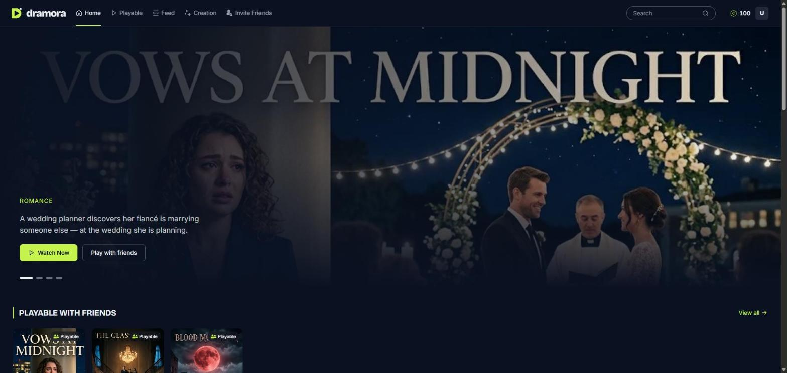
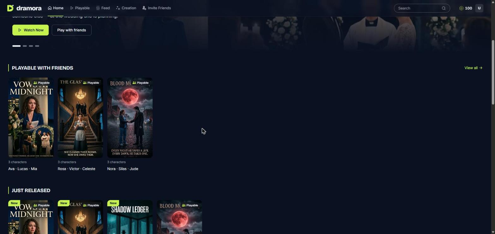
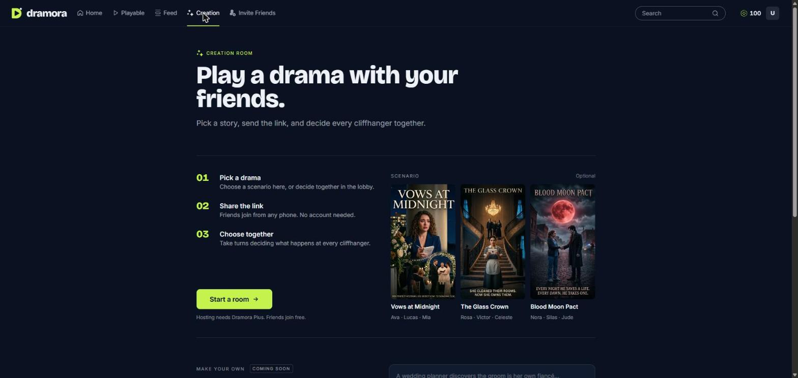
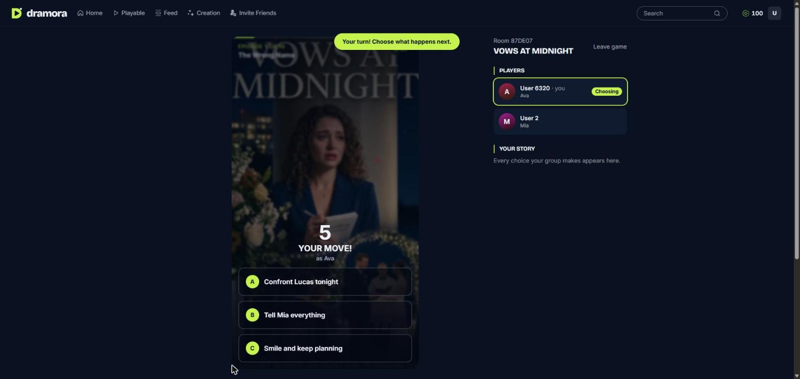
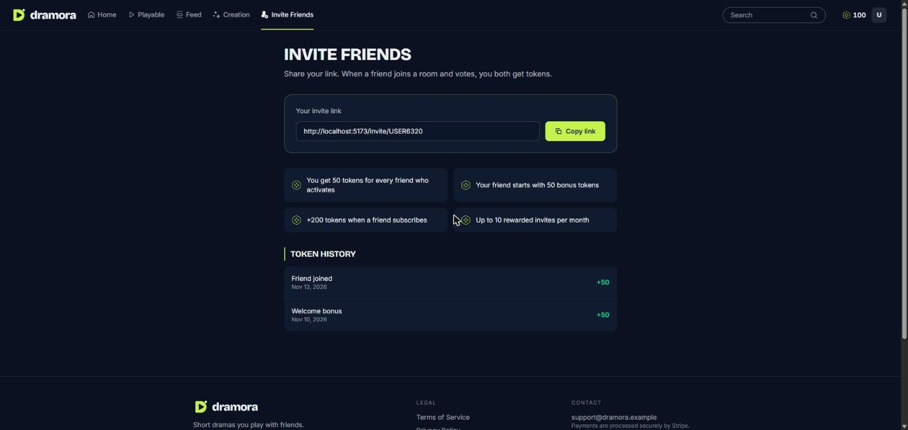
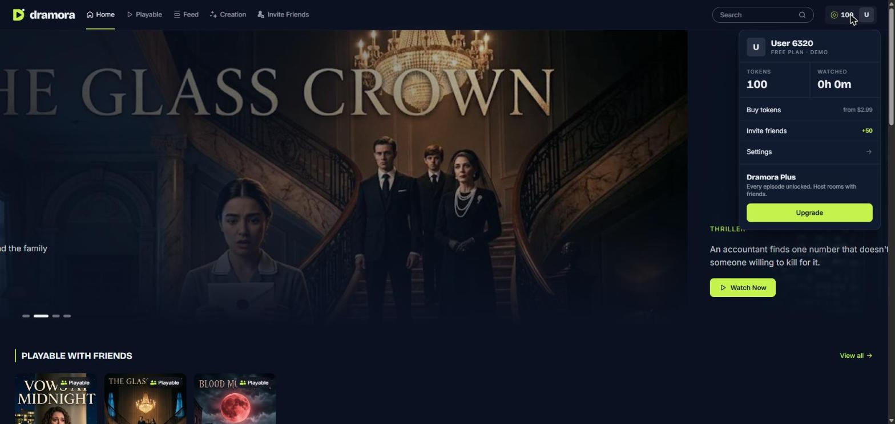

# Dramora By GreenLantern

Short vertical dramas you watch alone or play with friends. Each friend takes a character, and at every cliffhanger the group decides what happens next.

**Live:** https://dramora-dot-com.vercel.app



## Screens

| Playable dramas | Creation room |
|---|---|
|  |  |
| **Play mode: your turn** | **Invite friends and tokens** |
|  |  |



## Features

- **Watch** – 10-episode dramas with a vertical player, episode grid and plot notes. Episodes 1–6 are free.
- **Play with friends** – host a room, share a link, pick a scenario and characters, then take turns choosing one of three options at each cliffhanger. Choices can branch the story.
- **Dramora Plus** – weekly, monthly and yearly plans, plus one-time token packs. Tokens unlock single episodes.
- **Invites** – personal invite links with token rewards for both sides.


## Tech stack

| Layer | Tools |
|---|---|
| Frontend | Vue 3 (`<script setup>`), TypeScript, Vite |
| Routing / state / text | Vue Router, Pinia, vue-i18n |
| Styling | Tailwind CSS v4 |
| Backend | Supabase (Postgres, Auth, Realtime, Storage) |
| Payments | Stripe Checkout (planned) |
| Hosting | Vercel |

## Getting started

Requires Node.js 20+ (the scripts in `scripts/` need Node 23.6+ to run `.ts` directly).

```bash
npm install
npm run dev        # http://localhost:5173
npm run build      # type-check + production build into dist/
npm run preview    # serve the production build
```

### Demo mode

Without Supabase keys the app runs entirely in the browser with built-in demo data:

- every browser tab gets its own demo account (`User 1234`)
- purchases show a Yes/No confirmation and are not charged
- rooms sync between tabs of the same browser; use **Add demo player** in the lobby to play alone

### Connecting Supabase

1. Copy `.env.example` to `.env.local` and fill in `VITE_SUPABASE_URL`, `VITE_SUPABASE_ANON_KEY` and `SUPABASE_SERVICE_ROLE_KEY`.
2. Apply the schema and seed data: `supabase db reset` (or `supabase db push` and then run `supabase/seed.sql`).
3. Enable **Anonymous sign-ins** in Supabase Auth so guests can join rooms without an account.
4. Upload posters and previews to Storage: `npm run upload-media`.

Server-only keys (`SUPABASE_SERVICE_ROLE_KEY`, `STRIPE_*`) must never be prefixed with `VITE_`.

## Project structure

```
.
├── docs/screenshots/          README images
├── public/
│   ├── posters/               vertical posters + wide key art per drama
│   ├── previews/              short hover-preview clips
│   └── payments/              payment method badges
├── scripts/
│   ├── seed-episodes.ts       generates the episodes/choices block of seed.sql
│   └── upload-media.ts        uploads public/posters and public/previews to Storage
├── src/
│   ├── components/            header, footer, logo, poster cards, paywall, profile menu, cookie banner, icons
│   ├── composables/           settings, cookie consent, paywall state, watch time
│   ├── data/                  the only layer that talks to a backend
│   │   ├── index.ts           dramas, episodes, users, tokens, checkout
│   │   ├── rooms.ts           rooms, lobby and play-mode API
│   │   ├── turns.ts           turn order shared by client and server
│   │   ├── supabase.ts        Supabase client
│   │   └── demo*.ts           in-browser demo data and rooms
│   ├── locales/               all UI text (en.json) and legal pages (legal.en.json)
│   ├── router/                routes
│   ├── stores/                Pinia stores: auth, catalog, config, room, tokens
│   ├── views/                 Home, Feed, Watch, Create, Room, Play, Invite, Settings, Legal
│   ├── main.ts
│   └── style.css              design tokens, themes, base styles
├── supabase/
│   ├── migrations/            schema, access rules and server functions
│   └── seed.sql               config defaults and demo content
├── index.html
├── vercel.json                SPA rewrites for client-side routes
└── vite.config.ts
```

## Configuration

Business values are not hardcoded. They live in the `config` table (`supabase/seed.sql`), mirrored in `src/data/demo.ts` for demo mode:

| Key | Default | Purpose |
|---|---|---|
| `paywall.free_episodes` | `6` | free episodes per drama |
| `plans.plus` | weekly $5.99 · monthly $14.99 · yearly $119.99 | Dramora Plus plans |
| `tokens.packs` | $2.99 / 300 … $24.99 / 3,750 | token packs |
| `tokens.cost_unlock_episode` | `60` | tokens to unlock one episode |
| `play.episode_seconds` / `play.choice_seconds` | `30` / `5` | play-mode timers |
| `room.min_players` | `2` | players needed to start a room |
| `legal.*` | placeholders | company name, contact email, governing state |

UI text lives in `src/locales/`, colors and fonts in `src/style.css`, secrets in `.env.local`.

## Data and security

- All reads and writes go through `src/data/`; components never call Supabase directly.
- Row-level security on every table. Clients cannot write to rooms, votes or the token ledger directly; lobby actions, choices, token spending and episode unlocks run as server functions that check the rules.
- Video URLs for paid episodes are only returned to Dramora Plus members or users who unlocked the episode.
- The token balance is derived from an append-only ledger.

## Deployment

Vercel builds from the repository root (`npm run build`, output `dist`). `vercel.json` rewrites client-side routes such as `/room/:code` and `/watch/:slug/:episode` to `index.html`.

## Credits

Icons, fonts and trademarks are listed on the in-app **Credits** page (`/credits`).

© 2026 Dramora. All rights reserved.
